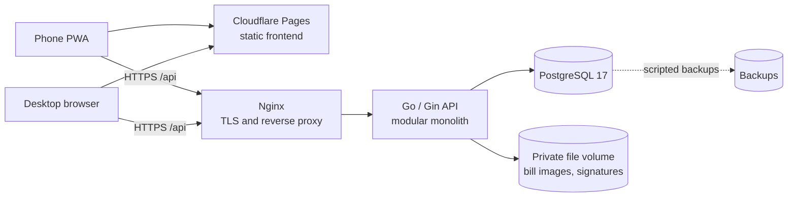
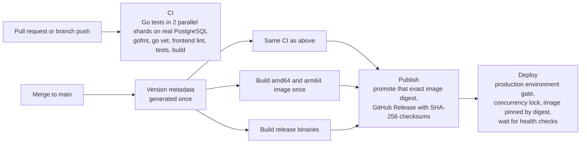

# 易管楼 (Easy Manage Building)

A meter-reading and billing SaaS for small landlords and sublandlords. Landlords record utility readings room by room, review charges, issue bills for a whole building in one pass, and send each tenant a bill image from their phone.

**Status:** closed beta with real landlords, who use it daily as an installed web app on their phones.
**Source:** private. This repository describes the architecture, delivery pipeline and design decisions. I'm happy to walk through the code in an interview.

## At a glance

| | |
| --- | --- |
| Backend | Go and Gin, a modular monolith, about 46k lines excluding tests |
| Frontend | React, Vite and TypeScript as a mobile-first PWA, about 32k lines |
| Data | PostgreSQL 17, 73 versioned migrations embedded in the binary and applied at startup |
| Tests | 124 Go test files including integration tests against a real PostgreSQL, plus frontend tests |
| Delivery | GitHub Actions: CI, release to GHCR, automatic deploy to a VPS |
| Hosting | API and database in Docker Compose behind Nginx (TLS); static frontend on Cloudflare Pages |

## Architecture

The API is one deployable binary split into modules with clear boundaries: authentication and sessions, properties and rooms, metering, billing, payments, bill rendering, platform fees, audit and idempotency. Modules call each other through application services; business rules stay in Go rather than in database triggers.

## Delivery pipeline

- **Build once, promote by digest.** The image that passed verification is the image that ships; the release only adds tags to it.
- **One deploy at a time.** A concurrency lock prevents overlapping deploys, and the production environment acts as an approval gate.
- **Rollback is a redeploy.** Any earlier release tag can be redeployed through the same workflow.
- **Supply chain hygiene.** Third-party actions are pinned to commit SHAs, each job gets only the permissions it needs, and old images are pruned automatically.
- **Path-aware CI.** Backend and frontend workflows run only when their files change.

## Design decisions

- **Money is stored in integer cents.** Rounding rules are explicit and bill totals are reproducible.
- **Issued bills are immutable snapshots.** Correcting a reading on a billed period voids that bill in the same transaction, so it can be reissued and the history stays traceable.
- **Strict isolation between landlords.** Data is separated per landlord account, and the API exposes public IDs rather than internal UUIDs.
- **Idempotent writes and an audit log.** Repeated submissions from flaky mobile networks don't create duplicate bills, and every change is recorded.
- **Session security.** Rotating refresh tokens, per-device sessions with an admin-set device limit, and supplier credentials encrypted with AES-GCM.
- **No premature infrastructure.** One VPS, no Redis, no background workers; batch billing runs synchronously until the load says otherwise.

## Contact

[LinkedIn](https://www.linkedin.com/in/zewen-l-531569327/) · [GitHub](https://github.com/z9wen)
